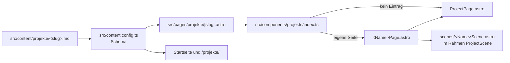

# Architektur der Projekte

<!-- Erzeugt von scripts/architektur.mjs. Nicht von Hand bearbeiten: npm run docs:architektur -->

> **Erzeugt, nicht geschrieben.** `npm run docs:architektur` schreibt diese Datei aus dem Code und
> den Projektdateien neu. CI prüft bei jedem Pull Request mit `npm run docs:check`, dass sie zum
> Stand des Repositorys passt, und wird rot, wenn nicht. Änderungen also an der Quelle machen, nie
> hier.

## Was dieses Dokument weiß und was nicht

Quelle für die Projekte sind die Dateien unter [`src/content/projekte`](../src/content/projekte): Stack, Art, Stand und die
technischen Entscheidungen, wie sie auf der Website stehen. Quelle für die Website ist ihr eigener
Code.

Die Projekte selbst liegen in eigenen Repositories. Ändert sich dort die Architektur, kommt das hier
erst an, wenn die Projektdatei nachgezogen wird. Dann zieht dieses Dokument im selben Commit mit, und
die öffentliche Projektseite gleich dazu.

## Überblick

10 Projekte, davon 8 veröffentlicht. Reihenfolge wie auf der Startseite.

| Projekt                               | Art             | Stack                                                                            | Stand                                                  | Live                                      | Auf der Website                       |
| ------------------------------------- | --------------- | -------------------------------------------------------------------------------- | ------------------------------------------------------ | ----------------------------------------- | ------------------------------------- |
| [PointCare](#pointcare)               | Kundenprojekt   | Vite, JavaScript, CSS, Scroll-Animationen, KI-Assets                             | In Abnahme.                                            | –                                         | nicht veröffentlicht, eigene Seite    |
| [JustBeauty](#justbeauty)             | Kundenprojekt   | Astro, GSAP, Lenis, TypeScript, Docker                                           | Prototyp und Konzept sind fertig für die Präsentation. | –                                         | nicht veröffentlicht, eigene Seite    |
| [Kleinkram](#kleinkram)               | Eigenes Produkt | Next.js 16, React 19, Drizzle ORM, SQLite, shadcn/ui, Tailwind, Recharts, Docker | Täglich im Einsatz bei Klartext selbst.                | –                                         | `/projekte/kleinkram/`, eigene Seite  |
| [TIEFGANG](#tiefgang)                 | Eigenes Produkt | TypeScript, Canvas 2D, Vite, PWA, Cloudflare Pages, GitHub Actions               | Spielbar.                                              | [Link](https://tiefgang.pages.dev)        | `/projekte/tiefgang/`, eigene Seite   |
| [MemoryTree](#memorytree)             | Eigenes Produkt | Python, FastAPI, SQLAlchemy, Alembic, Postgres, Vercel, Tailwind, Docker         | Läuft auf Vercel.                                      | [Link](https://memorytree-app.vercel.app) | `/projekte/memorytree/`, eigene Seite |
| [NoteList](#notelist)                 | Eigenes Produkt | Python, FastAPI, SQLite, Vanilla JS, Tailwind                                    | Läuft seit Sommer 2026 für eine kleine Gruppe.         | –                                         | `/projekte/notelist/`, eigene Seite   |
| [Feynman-Prototyp](#feynman-prototyp) | Prototyp        | Python, Flask, Ollama, JavaScript, pytest                                        | Prototyp mit Testsuite.                                | –                                         | `/projekte/feynman/`, eigene Seite    |
| [DealerSim](#dealersim)               | Eigenes Produkt | HTML, JavaScript, Canvas, Python-Tooling, Docker                                 | Spielbar.                                              | [Link](https://dealersim.vercel.app)      | `/projekte/dealersim/`, eigene Seite  |
| [Vaulter](#vaulter)                   | Eigenes Produkt | Python, FastAPI, yt-dlp, mlx-whisper, Claude, Swift, pytest                      | Im eigenen Gebrauch, alles Geplante ist gebaut.        | –                                         | `/projekte/vaulter/`, eigene Seite    |
| [Availably](#availably)               | Prototyp        | Swift, SwiftUI, TypeScript, Cloudflare Workers, Cloudflare D1                    | Prototyp.                                              | –                                         | `/projekte/availably/`, eigene Seite  |

### In mehreren Projekten

Gezählt aus `techStack`, Versionsnummern zusammengefasst.

| Technik    | Projekte                                                                                                        |
| ---------- | --------------------------------------------------------------------------------------------------------------- |
| Docker     | 4: [JustBeauty](#justbeauty), [Kleinkram](#kleinkram), [MemoryTree](#memorytree), [DealerSim](#dealersim)       |
| Python     | 4: [MemoryTree](#memorytree), [NoteList](#notelist), [Feynman-Prototyp](#feynman-prototyp), [Vaulter](#vaulter) |
| FastAPI    | 3: [MemoryTree](#memorytree), [NoteList](#notelist), [Vaulter](#vaulter)                                        |
| JavaScript | 3: [PointCare](#pointcare), [Feynman-Prototyp](#feynman-prototyp), [DealerSim](#dealersim)                      |
| Tailwind   | 3: [Kleinkram](#kleinkram), [MemoryTree](#memorytree), [NoteList](#notelist)                                    |
| TypeScript | 3: [JustBeauty](#justbeauty), [TIEFGANG](#tiefgang), [Availably](#availably)                                    |
| pytest     | 2: [Feynman-Prototyp](#feynman-prototyp), [Vaulter](#vaulter)                                                   |
| SQLite     | 2: [Kleinkram](#kleinkram), [NoteList](#notelist)                                                               |
| Swift      | 2: [Vaulter](#vaulter), [Availably](#availably)                                                                 |
| Vite       | 2: [PointCare](#pointcare), [TIEFGANG](#tiefgang)                                                               |

## Die Website

Astro, statisch generiert, ausgeliefert über GitHub Pages. Abhängigkeiten: `@astrojs/sitemap ^3.7.4`, `@tailwindcss/vite ^4.3.3`, `astro ^7.3.2`, `motion ^14.0.0`, `tailwindcss ^4.3.3`. Node `>=22`.

### Routen

- `/`
- `/datenschutz/`
- `/impressum/`
- `/projekte/`
- `/werkzeuge/`
- `/projekte/<slug>/` für jedes veröffentlichte Projekt: `kleinkram`, `tiefgang`, `memorytree`, `notelist`, `feynman`, `dealersim`, `vaulter`, `availably`
- `/404.html`

### Inhalte

Alle Texte liegen als Content Collections im Repository, das Schema steht in
[`src/content.config.ts`](../src/content.config.ts). Kein CMS, keine Datenbank.

| Collection   | Quelle                         |
| ------------ | ------------------------------ |
| `company`    | `src/content/company.json`     |
| `profile`    | `src/content/profile.json`     |
| `about`      | `src/content/about.md`         |
| `projekte`   | `src/content/projekte/**/*.md` |
| `skills`     | `src/content/skills.json`      |
| `leistungen` | `src/content/leistungen.json`  |
| `legal`      | `src/content/legal.json`       |
| `contact`    | `src/content/contact.json`     |

### Wie eine Projektseite entsteht

Die Projektdatei ist die einzige Quelle. Ohne Eintrag in [`src/components/projekte/index.ts`](../src/components/projekte/index.ts) bekommt
ein Projekt den gemeinsamen Körper [`src/components/ProjectPage.astro`](../src/components/ProjectPage.astro); mit Eintrag rendert
seine eigene Seitenkomponente diesen Körper und füllt dessen Slots, meist mit einer Bühne.

### Prüfen und Ausliefern

**CI** ([`.github/workflows/ci.yml`](../.github/workflows/ci.yml)), bei jedem Pull Request und jedem Push außer auf `main`:

- `check`: Checkout → Setup Node.js → Install dependencies → Typecheck (astro check) → Lint → Format → Architektur-Dokument aktuell → Build → Build prüfen (Routen, H1, Meta-Tags, tote Links, kein externes JS) → Rechtstext-Status

**Deploy to GitHub Pages** ([`.github/workflows/deploy.yml`](../.github/workflows/deploy.yml)), bei jedem Push auf `main` und Start von Hand:

- `build`: Checkout → Rechtstext prüfen → Setup Node.js → Install dependencies → Build → Build prüfen → Setup Pages → Upload artifact
- `deploy`: Deploy to GitHub Pages

## Projekte

### PointCare

Einseitige Website für eine Logistikberatung. Dunkel und filmisch, bewegt sich beim Scrollen mit und ersetzt eine Baukasten-Vorlage.

|                 |                                                                                        |
| --------------- | -------------------------------------------------------------------------------------- |
| Art             | Kundenprojekt                                                                          |
| Zeitraum        | September 2026                                                                         |
| Stand           | In Abnahme. Offen sind Portrait-Foto, Impressum, Kontaktformular und lokale Schriften. |
| Live            | –                                                                                      |
| Auf der Website | nicht veröffentlicht (`published: false`)                                              |

**Stack:** Vite · JavaScript · CSS · Scroll-Animationen · KI-Assets

**Architektur und technische Entscheidungen**

- Projektplan und Asset-Briefing vor der ersten Zeile Code
- Umstieg von Videos auf Standbilder mit Scroll-Zoom, weil die Videos die Ladezeit auf Mobilgeräten sprengten
- Bugfixes an Textüberlappung, Hero und Parallax dokumentiert statt still gefixt

**Auf der Website gebaut aus**

- Projektdatei: [`src/content/projekte/pointcare.md`](../src/content/projekte/pointcare.md)
- Seite: [`src/components/projekte/PointcarePage.astro`](../src/components/projekte/PointcarePage.astro) über [`src/components/ProjectPage.astro`](../src/components/ProjectPage.astro)
- Bühne und Bausteine: [`src/components/scenes/PointcareScene.astro`](../src/components/scenes/PointcareScene.astro), [`src/components/scenes/pointcare/StandbildKette.astro`](../src/components/scenes/pointcare/StandbildKette.astro), [`src/components/scenes/pointcare/StandbildLager.astro`](../src/components/scenes/pointcare/StandbildLager.astro), [`src/components/scenes/pointcare/StandbildTransport.astro`](../src/components/scenes/pointcare/StandbildTransport.astro), [`src/components/scenes/pointcare/Vorspann.astro`](../src/components/scenes/pointcare/Vorspann.astro), [`src/components/scenes/pointcare/perspektive.ts`](../src/components/scenes/pointcare/perspektive.ts)
- Bilder: keine

### JustBeauty

Bestandsaufnahme, neues Design und ein klickbarer Entwurf mit zwölf Seiten für einen Kosmetik-Shop.

|                 |                                                        |
| --------------- | ------------------------------------------------------ |
| Art             | Kundenprojekt                                          |
| Zeitraum        | September 2026                                         |
| Stand           | Prototyp und Konzept sind fertig für die Präsentation. |
| Live            | –                                                      |
| Auf der Website | nicht veröffentlicht (`published: false`)              |

**Stack:** Astro · GSAP · Lenis · TypeScript · Docker

**Architektur und technische Entscheidungen**

- Zentrales Master-Timing für alle Animationen – kein Modul definiert eigene Kurven
- Dev-Server über Docker Desktop startbar, damit der Kunde den Prototyp ohne Node-Setup ansehen kann
- 12 Pull Requests in 30 Commits – jede Route ein nachvollziehbarer Schritt

**Auf der Website gebaut aus**

- Projektdatei: [`src/content/projekte/justbeauty.md`](../src/content/projekte/justbeauty.md)
- Seite: [`src/components/projekte/JustbeautyPage.astro`](../src/components/projekte/JustbeautyPage.astro) über [`src/components/ProjectPage.astro`](../src/components/ProjectPage.astro)
- Bühne und Bausteine: [`src/components/scenes/JustbeautyScene.astro`](../src/components/scenes/JustbeautyScene.astro)
- Bilder: keine

### Kleinkram

Buchhaltung für Kleinunternehmer nach §19 UStG, die auf dem eigenen Rechner läuft. Rechnungen, Angebote, Arbeitszeiten, Fristen und Belege an einem Ort, dazu die Zahlen für die EÜR.

|                 |                                                              |
| --------------- | ------------------------------------------------------------ |
| Art             | Eigenes Produkt                                              |
| Zeitraum        | August – September 2026                                      |
| Stand           | Täglich im Einsatz bei Klartext selbst. Der Code ist privat. |
| Live            | –                                                            |
| Auf der Website | `/projekte/kleinkram/`                                       |

**Stack:** Next.js 16 · React 19 · Drizzle ORM · SQLite · shadcn/ui · Tailwind · Recharts · Docker

**Architektur und technische Entscheidungen**

- Alle Daten bleiben lokal in SQLite – kein Konto, kein Cloud-Sync
- Oberfläche aus Glas im hellen und dunklen Farbschema, die Kontraste prüft ein Skript bei jedem Check
- Läuft über Docker, damit die Installation ein Befehl ist
- Auf dem Mac als eigene App startbar, ohne Browser und Terminal; der Schreibtisch scheint durch das Fenster
- Automatische Tests für die Rechenregeln – Geld, Steuer, Kalenderwochen
- Randfälle in Backups behandelt – exFAT-Laufwerke und AppleDouble-Dateien

**Auf der Website gebaut aus**

- Projektdatei: [`src/content/projekte/kleinkram.md`](../src/content/projekte/kleinkram.md)
- Seite: [`src/components/projekte/KleinkramPage.astro`](../src/components/projekte/KleinkramPage.astro) über [`src/components/ProjectPage.astro`](../src/components/ProjectPage.astro)
- Bühne und Bausteine: [`src/components/scenes/KleinkramScene.astro`](../src/components/scenes/KleinkramScene.astro)
- Bilder: 4 in der Projektdatei

### TIEFGANG

Browser-Spiel über eine Mine. Wer tiefer gräbt, holt mehr heraus und geht mehr Risiko ein. Fürs Handy im Hochformat, mit einer Hand und auch ohne Internet spielbar.

|                 |                                                                                   |
| --------------- | --------------------------------------------------------------------------------- |
| Art             | Eigenes Produkt                                                                   |
| Zeitraum        | Juli – September 2026                                                             |
| Stand           | Spielbar. Nächster Schritt ist M6 – Balancing und Beta mit 5 bis 10 Testspielern. |
| Live            | https://tiefgang.pages.dev                                                        |
| Auf der Website | `/projekte/tiefgang/`                                                             |

**Stack:** TypeScript · Canvas 2D · Vite · PWA · Cloudflare Pages · GitHub Actions

**Architektur und technische Entscheidungen**

- Keine Game-Engine, keine Asset-Dateien – Sprites prozedural, Sound generativ über Web Audio
- Simulation strikt vom Rendering getrennt, damit sie headless läuft
- Deterministische Weltgenerierung aus einem Seed
- Eigener Balance-Simulator statt Test-Runner – 30 Bot-Runs und eine 400-Seed-Dichteprüfung
- Deploy per GitHub Actions auf Cloudflare Pages bei jedem Push

**Auf der Website gebaut aus**

- Projektdatei: [`src/content/projekte/tiefgang.md`](../src/content/projekte/tiefgang.md)
- Seite: [`src/components/projekte/TiefgangPage.astro`](../src/components/projekte/TiefgangPage.astro) über [`src/components/ProjectPage.astro`](../src/components/ProjectPage.astro)
- Bühne und Bausteine: [`src/components/scenes/TiefgangScene.astro`](../src/components/scenes/TiefgangScene.astro), [`src/components/scenes/tiefgang/Fahrzeug.astro`](../src/components/scenes/tiefgang/Fahrzeug.astro), [`src/components/scenes/tiefgang/Fund.astro`](../src/components/scenes/tiefgang/Fund.astro), [`src/components/scenes/tiefgang/Lupe.astro`](../src/components/scenes/tiefgang/Lupe.astro)
- Bilder: 5 in der Projektdatei

### MemoryTree

Web-App als gemeinsames Erinnerungsbuch für Paare. Fotos und Meilensteine wachsen als Baum, dazu Zeitleiste, Karte und Galerie.

|                 |                                                |
| --------------- | ---------------------------------------------- |
| Art             | Eigenes Produkt                                |
| Zeitraum        | März – September 2026                          |
| Stand           | Läuft auf Vercel. Öffentlich unter MIT-Lizenz. |
| Live            | https://memorytree-app.vercel.app              |
| Auf der Website | `/projekte/memorytree/`                        |

**Stack:** Python · FastAPI · SQLAlchemy · Alembic · Postgres · Vercel · Tailwind · Docker

**Architektur und technische Entscheidungen**

- Migration von SQLite lokal auf Postgres, Vercel Serverless und Vercel Blob – Alembic als einzige Schema-Quelle
- Rate-Limiting pro IP und Account, TrustedHost, X-Forwarded-For korrekt behandelt, ein CVE-Fix
- Regressionsskript, das die Mandanten-Isolation bei jeder Änderung prüft
- DB-Roundtrips pro Seite reduziert, Tailwind vom CDN auf Prebuild umgestellt, Region fra1

**Auf der Website gebaut aus**

- Projektdatei: [`src/content/projekte/memorytree.md`](../src/content/projekte/memorytree.md)
- Seite: [`src/components/projekte/MemorytreePage.astro`](../src/components/projekte/MemorytreePage.astro) über [`src/components/ProjectPage.astro`](../src/components/ProjectPage.astro)
- Bühne und Bausteine: [`src/components/scenes/MemorytreeScene.astro`](../src/components/scenes/MemorytreeScene.astro), [`src/components/scenes/memorytree/Belege.astro`](../src/components/scenes/memorytree/Belege.astro), [`src/components/scenes/memorytree/geometrie.ts`](../src/components/scenes/memorytree/geometrie.ts)
- Bilder: 6 in der Projektdatei

### NoteList

Notizen auf einer freien Fläche, verbunden wie ein Stammbaum und von mehreren Leuten gemeinsam bearbeitet. Läuft auf einem eigenen Kleinstrechner statt in einer Cloud.

|                 |                                                |
| --------------- | ---------------------------------------------- |
| Art             | Eigenes Produkt                                |
| Zeitraum        | Mai – Juli 2026                                |
| Stand           | Läuft seit Sommer 2026 für eine kleine Gruppe. |
| Live            | –                                              |
| Auf der Website | `/projekte/notelist/`                          |

**Stack:** Python · FastAPI · SQLite · Vanilla JS · Tailwind

**Architektur und technische Entscheidungen**

- Ausgelegt auf einen Raspberry Pi Zero 2 W mit 512 MB RAM – kein Frontend-Framework, kein JavaScript-Build. Nur das CSS baut Tailwind vorab auf dem Laptop, der Pi braucht zur Laufzeit kein Node
- FTS5 statt externer Suche, weil der Pi keine zweite Datenbank verträgt
- Die Fäden werden nicht gespeichert, sondern aus der Elternnotiz abgeleitet. Nur Querverbindungen sind eigene Zeilen in der Datenbank
- Der Abgleich holt nur, was sich seit dem letzten Mal geändert hat. Gelöschte Notizen protokolliert ein SQLite-Trigger
- Beim Ziehen bewegt sich eine Notiz nur per CSS-Transform, gespeichert wird einmal beim Loslassen
- Uvicorn mit reinem Python-Stack (asyncio, h11), weil die nativen Beschleuniger auf neuen Python-Versionen und macOS/ARM abstürzten
- Die App startet nicht ohne eigenen geheimen Schlüssel, und jede Änderung über die API braucht ein CSRF-Token

**Auf der Website gebaut aus**

- Projektdatei: [`src/content/projekte/notelist.md`](../src/content/projekte/notelist.md)
- Seite: [`src/components/projekte/NotelistPage.astro`](../src/components/projekte/NotelistPage.astro) über [`src/components/ProjectPage.astro`](../src/components/ProjectPage.astro)
- Bühne und Bausteine: [`src/components/scenes/NotelistScene.astro`](../src/components/scenes/NotelistScene.astro), [`src/components/scenes/notelist/Suche.astro`](../src/components/scenes/notelist/Suche.astro)
- Bilder: 4 in der Projektdatei

### Feynman-Prototyp

Lernprogramm mit einer KI, die auf dem eigenen Rechner läuft. Man erklärt einen Lernstoff in eigenen Worten, die KI prüft jede Aussage dagegen und weist auf Fehler hin, ohne die Lösung gleich zu verraten.

|                 |                                                                                    |
| --------------- | ---------------------------------------------------------------------------------- |
| Art             | Prototyp                                                                           |
| Zeitraum        | Juli – Oktober 2026                                                                |
| Stand           | Prototyp mit Testsuite. Läuft nur auf dem eigenen Rechner, deshalb ohne Live-Demo. |
| Live            | –                                                                                  |
| Auf der Website | `/projekte/feynman/`                                                               |

**Stack:** Python · Flask · Ollama · JavaScript · pytest

**Architektur und technische Entscheidungen**

- Der Prüfer sieht nur den Lernstoff und die eine Aussage, keinen Verlauf – so kann er dem Lernenden nicht nach dem Mund reden. Das Gedächtnis des Gesprächs liegt als Fehlerregister im Code
- Polaritätsprüfung als Gegenprobe – ein zweiter, getrennter Aufruf prüft, ob der Beleg die Aussage stützt oder ihr widerspricht. Sind sich beide uneinig, gilt die Aussage als unsicher
- Grounding-Fix gegen halluzinierte Lücken – jeder Befund braucht einen Beleg im Lernstoff, und der Prüfer darf dem Lernenden kein Zitat unterschieben
- Welcher Fehler als Nächstes drankommt, entscheidet fester Code ohne Sprachmodell. Der Tutor formuliert nur, und ein Filter fängt ab, wenn er die Lösung zu früh verrät
- Latenz-Experimente dokumentiert, auch die verworfenen

**Auf der Website gebaut aus**

- Projektdatei: [`src/content/projekte/feynman.md`](../src/content/projekte/feynman.md)
- Seite: [`src/components/projekte/FeynmanPage.astro`](../src/components/projekte/FeynmanPage.astro) über [`src/components/ProjectPage.astro`](../src/components/ProjectPage.astro)
- Bühne und Bausteine: [`src/components/scenes/FeynmanScene.astro`](../src/components/scenes/FeynmanScene.astro)
- Bilder: 4 in der Projektdatei

### DealerSim

Aufbau- und Managementspiel im Pixel-Look, das auch weiterläuft, wenn niemand spielt. Startet ohne Installation direkt im Browser.

|                 |                                                                                   |
| --------------- | --------------------------------------------------------------------------------- |
| Art             | Eigenes Produkt                                                                   |
| Zeitraum        | August – September 2026                                                           |
| Stand           | Spielbar. Grundausbau abgeschlossen, offen ist ein Spieltest mit echten Personen. |
| Live            | https://dealersim.vercel.app                                                      |
| Auf der Website | `/projekte/dealersim/`                                                            |

**Stack:** HTML · JavaScript · Canvas · Python-Tooling · Docker

**Architektur und technische Entscheidungen**

- Eigenes Sprite-Studio als Node-Dev-Server, das pixelweise bearbeitet und in die HTML-Datei zurückschreibt
- Headless-Test-Harnesse treiben die echten Game-Klassen ohne DOM
- Economy-Harness auf Reproduzierbarkeit repariert – Math.random geseedet
- Security-Fix beim Save-Parsing – Keys wie \_\_proto\_\_ werden verworfen

**Auf der Website gebaut aus**

- Projektdatei: [`src/content/projekte/dealersim.md`](../src/content/projekte/dealersim.md)
- Seite: [`src/components/projekte/DealersimPage.astro`](../src/components/projekte/DealersimPage.astro) über [`src/components/ProjectPage.astro`](../src/components/ProjectPage.astro)
- Bühne und Bausteine: [`src/components/scenes/DealersimScene.astro`](../src/components/scenes/DealersimScene.astro), [`src/components/scenes/dealersim/Skillzweig.astro`](../src/components/scenes/dealersim/Skillzweig.astro), [`src/components/scenes/dealersim/pixel.ts`](../src/components/scenes/dealersim/pixel.ts)
- Bilder: 5 in der Projektdatei

### Vaulter

Mac-Werkzeug, das aus einem Link zu YouTube, Instagram oder TikTok eine deutsche Notiz für die eigene Wissenssammlung in Obsidian macht. Nimmt auch Online-Besprechungen auf und schreibt live mit.

|                 |                                                                                                                                                                    |
| --------------- | ------------------------------------------------------------------------------------------------------------------------------------------------------------------ |
| Art             | Eigenes Produkt                                                                                                                                                    |
| Zeitraum        | September 2026                                                                                                                                                     |
| Stand           | Im eigenen Gebrauch, alles Geplante ist gebaut. Einige Wege sind bisher nur durch Tests gedeckt, etwa TikTok und die Aufnahme ohne Kopfhörer. Der Code ist privat. |
| Live            | –                                                                                                                                                                  |
| Auf der Website | `/projekte/vaulter/`                                                                                                                                               |

**Stack:** Python · FastAPI · yt-dlp · mlx-whisper · Claude · Swift · pytest

**Architektur und technische Entscheidungen**

- Die KI liefert strukturierte Daten, die Notiz entsteht aus einer eigenen Vorlage – so stimmt das Format immer, egal was das Modell antwortet
- Ohne KI, etwa bei einem Ausfall, entsteht trotzdem eine gültige Notiz aus Metadaten und Transkript
- Transkription lokal auf dem Mac mit Whisper; bei YouTube reichen vorhandene Untertitel, dann wird gar nichts heruntergeladen
- Jede Stufe speichert ihr Ergebnis – ein zweiter Lauf lädt, transkribiert und fragt nichts erneut
- Eine Quelle, eine Notiz – vorhandene Notizen erkennt Vaulter an der Quelle, nicht am Titel, und einsortierte Notizen fasst es nie an
- Mikrofon und Systemton als zwei getrennte Spuren über einen eigenen Swift-Helfer, so ist ohne Sprechererkennung klar, wer spricht

**Auf der Website gebaut aus**

- Projektdatei: [`src/content/projekte/vaulter.md`](../src/content/projekte/vaulter.md)
- Seite: [`src/components/projekte/VaulterPage.astro`](../src/components/projekte/VaulterPage.astro) über [`src/components/ProjectPage.astro`](../src/components/ProjectPage.astro)
- Bühne und Bausteine: [`src/components/scenes/VaulterScene.astro`](../src/components/scenes/VaulterScene.astro), [`src/components/scenes/vaulter/Frontmatter.astro`](../src/components/scenes/vaulter/Frontmatter.astro), [`src/components/scenes/vaulter/quellen.ts`](../src/components/scenes/vaulter/quellen.ts)
- Bilder: 3 in der Projektdatei

### Availably

iPhone-App für zwei Personen. Jeder setzt von Hand einen Status – Verfügbar, Beschäftigt, Fokus, Ruhe –, auf Wunsch mit Zeitlimit, und sieht ohne Nachfrage, ob der andere gerade ansprechbar ist.

|                 |                                                                                                                                                                                    |
| --------------- | ---------------------------------------------------------------------------------------------------------------------------------------------------------------------------------- |
| Art             | Prototyp                                                                                                                                                                           |
| Zeitraum        | Dezember 2025, Umbau September 2026                                                                                                                                                |
| Stand           | Prototyp. Alle Muss-Funktionen sind gebaut und im Simulator mit lokalem Server getestet. Der Server ist nicht in Betrieb, auf echten iPhones ist die App noch nicht durchgeklickt. |
| Live            | –                                                                                                                                                                                  |
| Auf der Website | `/projekte/availably/`                                                                                                                                                             |

**Stack:** Swift · SwiftUI · TypeScript · Cloudflare Workers · Cloudflare D1

**Architektur und technische Entscheidungen**

- Eigener kleiner Server: ein Cloudflare Worker mit D1. Mit einem kostenlosen Apple-Konto gibt es weder iCloud-Abgleich noch Push, deshalb wurde die Regel „ohne eigenes Backend“ bewusst gebrochen
- Der Server kennt je Gerät nur den aktuellen Stand, keine Historie. Gerätetoken und IP-Adressen liegen dort nur als Hash
- Vor dem ersten Verbinden spricht die App mit keinem Server
- Offline gesetzter Status wartet in einer Warteschlange; der neueste Wert gewinnt
- Entscheidungsregel aus dem Produktdokument: Macht das die App ruhiger oder lauter? Was lauter macht, wird nicht gebaut

**Auf der Website gebaut aus**

- Projektdatei: [`src/content/projekte/availably.md`](../src/content/projekte/availably.md)
- Seite: [`src/components/projekte/AvailablyPage.astro`](../src/components/projekte/AvailablyPage.astro) über [`src/components/ProjectPage.astro`](../src/components/ProjectPage.astro)
- Bühne und Bausteine: [`src/components/scenes/AvailablyScene.astro`](../src/components/scenes/AvailablyScene.astro)
- Bilder: 8 in der Projektdatei
- Aufnahmen: 6 Clips unter `public/aufnahmen/availably/`
