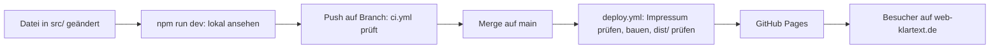

# Tech-Stack: Klartext-Website

> **Stand:** 2026-10-12 · **Commit:** `2b8eb15` · **Ausgefüllt von:** Claude Code nach
> [`vorlagen/TECH-STACK-VORLAGE.md`](vorlagen/TECH-STACK-VORLAGE.md) · **Geprüft von:** ❓ offen, erst
> nach Abschnitt 12

Wie die einzelnen Referenzprojekte gebaut sind und welche Routen es gerade gibt, steht in
[`ARCHITEKTUR.md`](ARCHITEKTUR.md). Die Datei wird aus dem Code erzeugt. Hier steht, was sich selten
ändert: woraus die Website besteht und warum.

---

## 1. In 30 Sekunden

**Was ist das?** Die Website des Einzelunternehmens Klartext. Sie zeigt Leistungen und Referenzen,
damit Selbstständige und kleine Unternehmen eine Anfrage per E-Mail schicken.

**Projektart:** statische Website.

**Denkbild:** eine Druckerei. Beim Bauen werden alle Seiten einmal fertig gedruckt, danach verteilt
GitHub Pages nur noch die Abzüge. Beim Besuch setzt niemand eine Seite neu zusammen.

**Das eine, was man verstanden haben muss:** Seiten entstehen beim Bauen, nicht beim Aufruf. Eine
Textänderung ist erst sichtbar, wenn neu gebaut und veröffentlicht wurde.

---

## 2. Der Stack nach Schichten

| Schicht            | Werkzeug (Version)                                                                                    | Wie tief? | Fundstelle                                          |
| ------------------ | ----------------------------------------------------------------------------------------------------- | --------- | --------------------------------------------------- |
| Sprache            | TypeScript 5, Astro-Komponenten (`.astro`), CSS                                                       | Kern      | `tsconfig.json`, `src/`                             |
| Framework          | Astro 7                                                                                               | Kern      | `astro.config.mjs`                                  |
| Darstellung        | Tailwind CSS 4 plus eigene Variablen; Schrift Instrument Sans aus dem Repository                      | Kern      | `src/styles/global.css`, `astro.config.mjs:18`      |
| Daten              | Content Collections: JSON- und Markdown-Dateien, deren Felder ein Schema prüft                        | Kern      | `src/content/`, `src/content.config.ts`             |
| Logik zur Laufzeit | Nur im Browser: kleine Skripte aus den Komponenten, Animationen mit Motion 14. Kein Server-Code.      | Kennen    | `src/lib/motion.ts`, `<script>` in `.astro`-Dateien |
| Identität          | Gibt es nicht. Kein Login, keine Nutzerkonten, kein Admin-Bereich.                                    | –         | –                                                   |
| Auslieferung       | GitHub Pages unter `web-klartext.de`                                                                  | Kennen    | `.github/workflows/deploy.yml`, `public/CNAME`      |
| Automatik          | GitHub Actions: `ci.yml` prüft Branches und Pull Requests, `deploy.yml` veröffentlicht `main`         | Kennen    | `.github/workflows/`                                |
| Qualität           | `astro check` (Typen), ESLint mit Barrierefreiheitsregeln, Prettier (Format), drei eigene Prüfskripte | Kennen    | `package.json` → `scripts`, `scripts/`              |
| Externe Dienste    | GitHub (Code, Automatik, Hosting), Domain-Registrar (DNS), E-Mail-Postfach bei webspace.bz            | Kennen    | `README.md`, Abschnitt „Domain“                     |

**Ignorieren darfst du:** `@astrojs/sitemap` (schreibt beim Bauen die Sitemap für Suchmaschinen),
`playwright` (fernsteuerbarer Browser, nur für `npm run screenshots`), `yaml` (liest Frontmatter im
Architektur-Skript), alle `eslint-*`- und `prettier-*`-Pakete (Zubehör der Prüfwerkzeuge).

---

## 3. Steckbriefe der Kern-Werkzeuge

### Astro

| Frage                             | Antwort                                                                                                                                                                                                                                                                                     |
| --------------------------------- | ------------------------------------------------------------------------------------------------------------------------------------------------------------------------------------------------------------------------------------------------------------------------------------------- |
| **Was ist das?**                  | Ein Werkzeug, das aus Bausteinen und Inhaltsdateien fertige HTML-Seiten baut.                                                                                                                                                                                                               |
| **Alltagsvergleich**              | Der Setzkasten der Druckerei: Kopfzeile, Projektkarte und Fußzeile werden zu fertigen Seiten zusammengesetzt, bevor jemand sie liest.                                                                                                                                                       |
| **Welches Problem löst es hier?** | Gemeinsame Teile nur einmal schreiben und trotzdem einzelne HTML-Seiten mit eigener Adresse, eigenem Titel und eigenen Meta-Tags ausliefern, ohne Server.                                                                                                                                   |
| **Woran erkenne ich es im Code?** | Dateien `.astro`. Oben zwischen den beiden `---` steht Code, der **nur beim Bauen** läuft; darunter HTML. Jede Datei in `src/pages/` wird eine Adresse. `src/pages/projekte/[slug].astro` ist eine Vorlage für viele Seiten: `getStaticPaths()` sagt Astro, welche Seiten daraus entstehen. |
| **Was wäre ohne es?**             | Jede Seite von Hand als HTML pflegen und Kopf- und Fußzeile überall kopieren. Oder eine App, die Seiten erst im Browser zusammensetzt: So war die Website vorher gebaut, mit kaputten Direktlinks und 166 KB JavaScript (gzip) (`docs/REWORK_PLAN.md`, Entscheidung 1).                     |
| **Verworfene Alternativen**       | React-Single-Page-App behalten: Direktlinks auf GitHub Pages nur mit Umleitungstrick, viel JavaScript. Next.js mit statischem Export: kann es, bringt aber Konzepte mit, die hier ungenutzt blieben. Beides in `docs/REWORK_PLAN.md`, Entscheidung 1.                                       |
| **Wenn du schon React kennst**    | Eine `.astro`-Datei ist wie eine React-Komponente, deren Funktionskörper genau einmal beim Bauen läuft. Kein State, kein Neu-Rendern im Browser. `props` heißen `Astro.props`, `children` heißt `<slot />`. Was im Browser reagieren soll, steht in einem eigenen `<script>`-Block.         |
| **Offizielle Doku**               | <https://docs.astro.build/de/getting-started/>                                                                                                                                                                                                                                              |

### Content Collections (mit Zod)

| Frage                             | Antwort                                                                                                                                                                                                                       |
| --------------------------------- | ----------------------------------------------------------------------------------------------------------------------------------------------------------------------------------------------------------------------------- |
| **Was ist das?**                  | Astros Art, Inhalte aus Dateien zu lesen und vor dem Bauen zu prüfen, ob jedes Pflichtfeld da ist und den richtigen Typ hat. Die Regeln schreibt man mit Zod, einer Bibliothek für solche Prüfregeln (Schema).                |
| **Alltagsvergleich**              | Ein Auftragsformular mit Pflichtfeldern. Fehlt etwas oder steht Unsinn drin, nimmt die Druckerei den Auftrag gar nicht erst an.                                                                                               |
| **Welches Problem löst es hier?** | Texte ohne Datenbank und ohne Admin-Bereich pflegen. Ein fehlender Titel oder ein Platzhalter wie `[PLZ Ort]` im Impressum bricht den Build, statt live zu gehen (`src/content.config.ts`, Kommentar über `legal`).           |
| **Woran erkenne ich es im Code?** | `src/content.config.ts` mit `defineCollection` und `z.string()`, `z.boolean()` usw. In Seiten und Komponenten `getCollection('projekte')` oder `getEntry('company', 'main')`.                                                 |
| **Was wäre ohne es?**             | Texte direkt in den Komponenten. Vorher lagen sie in `DEFAULT_CONTENT` und wurden über einen Admin-Bereich im `localStorage` des Browsers bearbeitet (`src/content.config.ts:6`).                                             |
| **Verworfene Alternativen**       | Headless CMS (Decap, Keystatic): bräuchte Login, einen OAuth-Anbieter und einen weiteren Datenschutz-Abschnitt, für Inhalte, die sich ein paar Mal im Semester ändern (`docs/REWORK_PLAN.md`, Entscheidung 1, Alternative C). |
| **Offizielle Doku**               | <https://docs.astro.build/de/guides/content-collections/>                                                                                                                                                                     |

### Tailwind CSS

| Frage                             | Antwort                                                                                                                                                             |
| --------------------------------- | ------------------------------------------------------------------------------------------------------------------------------------------------------------------- |
| **Was ist das?**                  | CSS in Form kurzer Klassennamen direkt im HTML: `mx-auto max-w-5xl px-4` statt einer eigenen CSS-Regel.                                                             |
| **Alltagsvergleich**              | Ein Baukasten mit genormten Teilen statt Maßanfertigung für jede Stelle.                                                                                            |
| **Welches Problem löst es hier?** | Layout und Abstände direkt am Element, einheitlich. Farben, Schrift, Kurven und Dauern stehen zusätzlich als eigene Variablen in `src/styles/global.css`.           |
| **Woran erkenne ich es im Code?** | Lange `class="…"`-Attribute in `.astro`-Dateien. `@import 'tailwindcss'` in der ersten Zeile von `global.css`. Das Plugin `tailwindcss()` in `astro.config.mjs:41`. |
| **Was wäre ohne es?**             | Jede Regel in eigenen CSS-Dateien, mit eigenen Klassennamen.                                                                                                        |
| **Verworfene Alternativen**       | ❓ offen: Tailwind wurde aus der Vorgängerversion übernommen (`docs/REWORK_PLAN.md`, Entscheidung 1). Eine Abwägung gegen reines CSS steht nirgends.                |
| **Offizielle Doku**               | <https://tailwindcss.com/docs>                                                                                                                                      |

### GitHub Actions und GitHub Pages

| Frage                             | Antwort                                                                                                                                                                                               |
| --------------------------------- | ----------------------------------------------------------------------------------------------------------------------------------------------------------------------------------------------------- |
| **Was ist das?**                  | Actions sind Rechner bei GitHub, die bei jedem Push festgelegte Befehle ausführen. Pages ist GitHubs Hosting für fertige Dateien.                                                                     |
| **Alltagsvergleich**              | Actions sind Qualitätskontrolle und Lieferwagen, Pages ist das Schaufenster.                                                                                                                          |
| **Welches Problem löst es hier?** | Merge auf `main` genügt: Bauen, Prüfen und Veröffentlichen laufen von selbst. Es gibt keinen eigenen Server, der gewartet werden muss.                                                                |
| **Woran erkenne ich es im Code?** | `.github/workflows/ci.yml` und `deploy.yml`. Im Browser: Reiter „Actions“ im Repository.                                                                                                              |
| **Was wäre ohne es?**             | Lokal bauen und `dist/` von Hand auf einen Webspace hochladen. Jede Prüfung hinge davon ab, dass man daran denkt.                                                                                     |
| **Verworfene Alternativen**       | ❓ offen: Andere Projekte nutzen Vercel und Cloudflare Pages (`docs/ARCHITEKTUR.md`). Warum die Website bei GitHub Pages bleibt, ist nicht begründet. Naheliegend, aber unbelegt: Sie lag schon dort. |
| **Offizielle Doku**               | <https://docs.github.com/de/actions>, <https://docs.github.com/de/pages>                                                                                                                              |

### Motion (Kennen)

Animationsbibliothek für den Browser: Sektionen ziehen ein, der Hero spielt beim Scrollen eine
Geschichte ab. **Wichtig:** Nie direkt aus `motion` importieren, sondern aus `src/lib/motion.ts`
(`motion.ts:19`). Dort stehen die gemeinsamen Dauern und Kurven, und dort wird geprüft, ob der Besucher
reduzierte Bewegung eingestellt hat. Ohne JavaScript steht jeder Inhalt sofort da. Doku:
<https://motion.dev/docs>.

---

## 4. Wann läuft welcher Code?

> **Die wichtigste Regel dieses Projekts:** Code zwischen den `---` einer `.astro`-Datei läuft nie
> beim Besucher. Nur `<script>`-Blöcke und CSS kommen im Browser an.

| Zeitpunkt                     | Wo                               | Was läuft                                                                                                                                                                                                       | Beispiel-Datei                                             |
| ----------------------------- | -------------------------------- | --------------------------------------------------------------------------------------------------------------------------------------------------------------------------------------------------------------- | ---------------------------------------------------------- |
| Beim Entwickeln               | dein Rechner                     | `npm run dev`: Astro baut jede Seite bei jedem Speichern neu und lädt den Browser nach.                                                                                                                         | –                                                          |
| Beim Bauen (Build)            | dein Rechner oder GitHub Actions | Inhalte gegen das Schema prüfen, Frontmatter aller `.astro`-Dateien ausführen, aus `getStaticPaths()` die Projektseiten erzeugen, Tailwind-CSS erzeugen, Skripte bündeln, Bilder optimieren. Ergebnis: `dist/`. | `src/content.config.ts`, `src/pages/projekte/[slug].astro` |
| Auf dem Server, pro Anfrage   | GitHub Pages                     | Nichts. Pages liefert nur fertige Dateien aus.                                                                                                                                                                  | –                                                          |
| Im Browser                    | beim Besucher                    | Gebündelte `<script>`-Blöcke der Komponenten, Animationen mit Motion, einige kleine Inline-Skripte (zwei davon im `<head>`), Seitenübergänge per CSS (View Transitions).                                        | `src/lib/motion.ts`, `src/components/MotionReady.astro`    |
| Im Hintergrund, zeitgesteuert | –                                | Nichts.                                                                                                                                                                                                         | –                                                          |

### Der Weg einer Änderung bis zum Besucher

1. **Lokal ändern und ansehen** – z. B. `src/content/company.json`, Ergebnis unter
   <http://localhost:4321/>. _Kann scheitern an:_ Schema-Fehler. Die Meldung nennt Datei und Feld.
2. **Push auf einen Branch** – `ci.yml` läuft: Typen, Lint, Format, Architektur-Dokument aktuell,
   Build, Build prüfen. _Kann scheitern an:_ `npm run format` vergessen; neue Projektdatei ohne
   `npm run docs:architektur` (`ci.yml:43`).
3. **Merge auf `main`** – `ci.yml` läuft hier nicht mehr (`ci.yml:6`), nur noch `deploy.yml`. Wer
   direkt auf `main` pusht, überspringt also Lint, Format und Typprüfung.
4. **Deploy** – zuerst `guard-legal.mjs` (`deploy.yml:27`), dann Build und `test:build`, dann wird
   `dist/` zu Pages hochgeladen (`deploy.yml:48`). _Kann scheitern an:_ fehlende Anschrift im
   Impressum, falsche Pages-Einstellung (siehe Abschnitt 10).
5. **Pages liefert aus** – nach wenigen Minuten. _Kann scheitern an:_ nichts im Repository; DNS oder
   Browser-Cache.

---

## 5. Ordnerkarte

| Ordner / Datei             | Was liegt da                                                                                                   | Fasse ich an?                 |
| -------------------------- | -------------------------------------------------------------------------------------------------------------- | ----------------------------- |
| `src/content/`             | Alle Texte als JSON und Markdown, eine Datei je Referenz unter `projekte/`                                     | oft                           |
| `src/content.config.ts`    | Die Schemas: welche Felder jede Inhaltsdatei haben muss                                                        | wenn ein neues Feld dazukommt |
| `src/pages/`               | Eine Datei je Adresse, `projekte/[slug].astro` für alle Projektseiten                                          | selten                        |
| `src/components/`          | Bausteine. `home/` die Sektionen der Startseite, `projekte/` eigene Projektseiten, `scenes/` die Projektbühnen | beim Gestalten oft            |
| `src/layouts/`             | Der Seitenrahmen: `<html>`, `<head>`, Header, Footer                                                           | selten                        |
| `src/styles/global.css`    | Farben, Schrift, Tailwind-Einbindung, Grundregeln für Bewegung                                                 | selten                        |
| `src/lib/`                 | Helfer: `href()` für interne Links, `mailto()`, die Bewegungsregeln                                            | selten                        |
| `src/assets/`              | Bilder und Schrift, die Astro beim Bauen optimiert                                                             | bei neuen Bildern             |
| `public/`                  | Dateien, die unverändert ausgeliefert werden: `CNAME`, `robots.txt`, `favicon.svg`, Aufnahmen                  | selten                        |
| `scripts/`                 | Prüf- und Hilfsskripte. Laufen auf deinem Rechner oder in CI, nie beim Besucher                                | selten                        |
| `.github/workflows/`       | CI und Deploy                                                                                                  | selten                        |
| `docs/`                    | Pläne und Begründungen. `ARCHITEKTUR.md` wird erzeugt                                                          | `ARCHITEKTUR.md` nie von Hand |
| `dist/`                    | Ergebnis des Builds, steht nicht im Git                                                                        | nie (wird erzeugt)            |
| `.astro/`, `node_modules/` | Von Astro erzeugte Typen, installierte Pakete                                                                  | nie (wird erzeugt)            |

---

## 6. Befehle

### Vom leeren Rechner zur laufenden Seite

1. Voraussetzungen: Node.js 22 oder neuer (`node -v`), Git. Keine `.env`-Datei, keine Konten, kein
   Docker.
2. `git clone https://github.com/User420-bit/Website.git && cd Website`
3. `npm ci` – installiert genau die Versionen aus `package-lock.json`.
4. `npm run dev` – danach <http://localhost:4321/> öffnen.

### Alltag

| Befehl                     | Was passiert                                                  | Wann brauche ich ihn                      |
| -------------------------- | ------------------------------------------------------------- | ----------------------------------------- |
| `npm run dev`              | Startet die lokale Vorschau, aktualisiert bei jedem Speichern | beim Arbeiten                             |
| `npm run verify`           | Alle Prüfungen von CI in einem Durchlauf, inklusive Build     | vor jedem Push                            |
| `npm run format`           | Formatiert alle Dateien mit Prettier                          | wenn CI bei „Format“ rot ist              |
| `npm run docs:architektur` | Schreibt `docs/ARCHITEKTUR.md` neu                            | nach jeder Änderung an einer Projektdatei |
| `npm run build`            | Baut die fertige Seite nach `dist/`                           | selten einzeln, steckt in `verify`        |
| `npm run preview`          | Zeigt den Inhalt von `dist/` so, wie Pages ihn ausliefert     | wenn lokal etwas anders aussieht als live |
| `npm run guard:legal`      | Prüft, ob das Impressum vollständig ist                       | wenn der Deploy beim Impressum abbricht   |

Alle Befehle mit Erklärung: `README.md`, Abschnitt „Scripts“.

---

## 7. Daten, Zustand und Geheimnisse

| Frage                                  | Antwort                                                                                                                                                                        | Fundstelle                                    |
| -------------------------------------- | ------------------------------------------------------------------------------------------------------------------------------------------------------------------------------ | --------------------------------------------- |
| Wo liegen die Inhalte?                 | Als Dateien in `src/content/`, versioniert in Git                                                                                                                              | `src/content.config.ts:244`                   |
| Wo liegen Nutzerdaten?                 | Es gibt keine.                                                                                                                                                                 | –                                             |
| Gibt es eine Datenbank?                | Nein. Sie wurde mit dem Neuaufbau bewusst abgeschafft.                                                                                                                         | `docs/REWORK_PLAN.md`, Entscheidung 2         |
| Was speichert der Browser?             | Nichts: keine Cookies, kein `localStorage`. Der Farbmodus folgt der Systemeinstellung.                                                                                         | `src/pages/datenschutz.astro:86`, `README.md` |
| Was passiert mit Eingaben von Nutzern? | Es gibt kein Formular. Anfrage-Knöpfe öffnen das E-Mail-Programm (`mailto:`) mit vorausgefülltem Betreff. Die Nachricht geht an `info@web-klartext.de`, außerhalb der Website. | `src/lib/site.ts:41`                          |
| Wo liegen Zugangsdaten?                | Im Projekt keine. Der Deploy nutzt GitHubs eingebaute Berechtigung (`pages: write`, `id-token: write`), keine eigenen Secrets.                                                 | `.github/workflows/deploy.yml`                |
| Gibt es Backups?                       | Für die Website ist Git das Backup: Jede Fassung jeder Datei liegt in der Historie. ❓ offen: Backup des Postfachs bei webspace.bz.                                            | –                                             |

---

## 8. Externe Dienste

| Dienst           | Wofür                                            | Wenn er ausfällt …                                                               | Kosten    | Konto bei     |
| ---------------- | ------------------------------------------------ | -------------------------------------------------------------------------------- | --------- | ------------- |
| GitHub           | Code, Automatik, Hosting                         | Seite nicht erreichbar, kein Deploy. Ein lokaler Klon hat alles für einen Umzug. | ❓ offen  | `User420-bit` |
| Domain-Registrar | `web-klartext.de`, DNS-Einträge auf GitHub Pages | Domain zeigt ins Leere, die Seite ist für Besucher nicht erreichbar              | ❓ offen  | ❓ offen      |
| webspace.bz      | Postfach `info@web-klartext.de`                  | Anfragen kommen nicht an, die Seite läuft weiter                                 | ❓ offen  | ❓ offen      |
| npm-Registry     | Pakete beim Installieren                         | Kein Build und kein Deploy möglich; die Live-Seite bleibt unberührt              | kostenlos | –             |

---

## 9. Entscheidungen

| Entscheidung                                                                    | Warum                                                                                                                                                                                              | Preis                                                                                                     | Neu entscheiden, wenn …                                  |
| ------------------------------------------------------------------------------- | -------------------------------------------------------------------------------------------------------------------------------------------------------------------------------------------------- | --------------------------------------------------------------------------------------------------------- | -------------------------------------------------------- |
| Statisch gebaut statt App im Browser                                            | Jede Adresse ist echtes HTML, Direktlinks funktionieren, kaum JavaScript (`docs/REWORK_PLAN.md`, Entscheidung 1)                                                                                   | Jede Änderung braucht Build und Deploy; nichts kann auf einzelne Besucher reagieren                       | ein Kundenbereich oder Login nötig wird                  |
| Inhalte als Dateien mit Schema statt CMS oder Admin-Bereich                     | Ein Bearbeiter, Versionierung über Git, Fehler brechen den Build (`docs/REWORK_PLAN.md`, Entscheidung 2)                                                                                           | Bearbeiten nur über Git oder den GitHub-Editor, nicht in einer Oberfläche                                 | jemand ohne Git-Kenntnisse Texte pflegen soll            |
| Kontakt per `mailto:` statt Formular                                            | Kein Server, keine Daten auf der Website, kein Spam-Schutz nötig                                                                                                                                   | Wer kein Mailprogramm eingerichtet hat, muss die Adresse kopieren (dafür gibt es `CopyEmail.astro`)       | Anfragen strukturiert erfasst oder gezählt werden sollen |
| Keine Drittanbieter: Schrift lokal, kein Tracking, JS nur aus dem eigenen Build | Datenschutz ohne Einwilligungsbanner (`README.md`, „Datenschutz“). `test:build` lehnt Skripte von außerhalb des Builds ab und begrenzt JavaScript auf 100 KB je Seite (`scripts/verify-build.mjs`) | Keine Besucherstatistik                                                                                   | Marketing Zahlen braucht                                 |
| Deploy blockiert ohne vollständiges Impressum                                   | Impressumspflicht. „Vorsätze halten nicht“ (`scripts/guard-legal.mjs`, Kopfkommentar)                                                                                                              | Lokal und CI grün, aber der Deploy rot, bis die Anschrift eingetragen ist                                 | –                                                        |
| Architektur-Dokument wird erzeugt, CI prüft es                                  | Handgeschriebene Doku veraltet unbemerkt (`scripts/architektur.mjs`, Kopfkommentar)                                                                                                                | Nach jeder Projektänderung `npm run docs:architektur`, sonst ist CI rot                                   | –                                                        |
| Gemeinsamer Seitenkörper plus eine eigene Bühne je Referenz                     | Jede Seite zeigt, dass sie ihr Projekt verstanden hat; der gleiche Rahmen hält jede Referenz gleich ehrlich aufgebaut (`docs/PROJEKTSZENEN_PLAN.md`, Abschnitt 0)                                  | Jede Bühne wird einzeln gepflegt. Bühnen und eigene Projektseiten sind rund 60 % der Codezeilen in `src/` | die Zahl der Referenzen deutlich wächst                  |

---

## 10. Rezepte und Fehlersuche

### Wo ändere ich …?

| Aufgabe                       | Datei(en)                                                                                             | Danach prüfen mit                |
| ----------------------------- | ----------------------------------------------------------------------------------------------------- | -------------------------------- |
| Einen Text                    | die passende Datei in `src/content/`, Tabelle in `README.md`, „Inhalt ändern“                         | `npm run dev`                    |
| Den Claim (H1) der Startseite | `src/content/company.json` **und** `scripts/verify-build.mjs`, Konstante `ROUTES`                     | `npm run verify`                 |
| Eine neue Referenz            | neue Datei `src/content/projekte/<slug>.md`, danach `npm run docs:architektur`                        | `npm run verify`                 |
| Eine Referenz verstecken      | `published: false` im Frontmatter der Projektdatei                                                    | `npm run build`, die Seite fehlt |
| Farben, Schrift, Abstände     | `src/styles/global.css`                                                                               | `npm run dev`, hell und dunkel   |
| Eine neue Unterseite          | neue Datei in `src/pages/`, Rahmen `BaseLayout`; Route und H1 in `scripts/verify-build.mjs` eintragen | `npm run verify`                 |
| Die Domain                    | `public/CNAME`, `site` in `astro.config.mjs`, `public/robots.txt`, GitHub-Einstellungen → Pages       | `README.md`, Abschnitt „Domain“  |

### Wenn etwas kaputt ist

| Symptom                                             | Ursache meistens                                                      | Zuerst nachsehen / tun                                          |
| --------------------------------------------------- | --------------------------------------------------------------------- | --------------------------------------------------------------- |
| CI rot bei „Format“                                 | Datei nicht mit Prettier formatiert                                   | `npm run format`, committen                                     |
| CI rot bei „Architektur-Dokument aktuell“           | Projektdatei geändert, Dokument nicht neu erzeugt                     | `npm run docs:architektur`, committen                           |
| Build bricht mit Schema-Fehler ab                   | Pflichtfeld fehlt oder Platzhalter in eckigen Klammern                | Die Meldung nennt Datei und Feld; Regeln in `content.config.ts` |
| `test:build` meldet falsche H1                      | Claim geändert, `verify-build.mjs` nicht nachgezogen                  | `ROUTES` in `scripts/verify-build.mjs`                          |
| Deploy bricht ab: „Das Impressum ist unvollständig“ | `street` oder `zipCity` in `legal.json` ist `null`                    | Anschrift eintragen                                             |
| Deploy bricht ab: „Get Pages site failed“           | Pages-Quelle steht nicht auf GitHub Actions                           | GitHub → Settings → Pages → Source                              |
| Ein Projekt hat keine eigene Seite                  | `published: false`                                                    | Frontmatter der Projektdatei; Filter in `[slug].astro:14`       |
| Änderung ist live nicht zu sehen                    | Noch nicht auf `main`, Deploy läuft noch oder ist rot, Browser-Cache  | Reiter „Actions“ im Repository                                  |
| Animationen fehlen                                  | Reduzierte Bewegung im Betriebssystem (gewollt) oder ein Skriptfehler | Systemeinstellung, dann Konsole der Browser-Entwicklertools     |

---

## 11. Glossar

| Begriff                     | Bedeutung in einem Satz                                                     | Hier im Projekt                                                         |
| --------------------------- | --------------------------------------------------------------------------- | ----------------------------------------------------------------------- |
| Build (Bauen)               | Aus Quelldateien die auslieferbaren Dateien erzeugen                        | `npm run build`, Ergebnis in `dist/`                                    |
| Statische Website           | Alle Seiten liegen fertig als Dateien vor, kein Server rechnet beim Aufruf  | die ganze Website                                                       |
| Framework                   | Fertiges Gerüst, das Struktur und Werkzeuge vorgibt                         | Astro                                                                   |
| Komponente                  | Wiederverwendbarer Baustein einer Seite                                     | alles in `src/components/`                                              |
| Frontmatter                 | Kopfbereich einer Datei zwischen zwei `---`-Zeilen                          | in `.astro`: Code zur Bauzeit; in `.md`: Daten wie `title`, `published` |
| Schema                      | Regeln, welche Felder ein Datensatz haben muss und welchen Typ sie haben    | `src/content.config.ts`                                                 |
| Zod                         | Bibliothek, mit der man Schemas in TypeScript schreibt                      | `z.string()`, `z.boolean()` in `content.config.ts`                      |
| Content Collection          | Eine Gruppe gleichartiger Inhaltsdateien mit gemeinsamem Schema             | `projekte`, `company`, `legal` …                                        |
| Slug                        | Der lesbare Teil einer Adresse, meist aus dem Dateinamen                    | `kleinkram` in `/projekte/kleinkram/`                                   |
| Route                       | Eine Adresse der Website und die Datei, die sie erzeugt                     | `src/pages/impressum.astro` → `/impressum/`                             |
| `getStaticPaths()`          | Astro-Funktion, die sagt, welche Seiten eine Vorlage erzeugen soll          | `src/pages/projekte/[slug].astro:12`                                    |
| Bündeln (Bundle)            | Viele Skriptdateien beim Bauen zu wenigen zusammenfassen                    | alle `<script>`-Blöcke landen gebündelt in `dist/`                      |
| CI (Continuous Integration) | Automatische Prüfung bei jedem Push                                         | `.github/workflows/ci.yml`                                              |
| Workflow                    | Eine Datei, die GitHub Actions sagt, was wann laufen soll                   | `ci.yml`, `deploy.yml`                                                  |
| Deploy                      | Die gebaute Fassung veröffentlichen                                         | `.github/workflows/deploy.yml`                                          |
| DNS, `CNAME`                | Das Telefonbuch des Internets: welcher Name zu welchem Server gehört        | `public/CNAME`, Einträge beim Registrar (`README.md`)                   |
| Lint                        | Automatische Suche nach fehleranfälligen Mustern im Code                    | ESLint, `npm run lint`                                                  |
| Typecheck                   | Prüfung, ob Werte zu den erwarteten Typen passen, ohne den Code auszuführen | `npm run check` (`astro check`)                                         |
| Formatierer                 | Werkzeug, das Einrückung und Zeilenumbrüche vereinheitlicht                 | Prettier, `npm run format`                                              |
| `mailto:`                   | Link, der das E-Mail-Programm öffnet statt einer Webseite                   | alle Anfrage-Knöpfe, `src/lib/site.ts:41`                               |
| View Transition             | Browserfunktion für weiche Übergänge beim Seitenwechsel                     | Bühne ↔ Projektseite, `ProjectTransition.astro`                         |
| `prefers-reduced-motion`    | Systemeinstellung, mit der Menschen Animationen abschalten                  | `bewegt()` in `src/lib/motion.ts`                                       |
| Hot Reload                  | Der Browser aktualisiert sich beim Speichern von selbst                     | `npm run dev`                                                           |

---

## 12. Verständnis-Check

Die Antworten schreibst du selbst, aus dem Kopf. Dann aufklappen und vergleichen. Erst wenn alle
sitzen, oben bei „Geprüft von“ eintragen.

**1. Was passiert zwischen „ich ändere den Claim in `company.json`“ und „ein Besucher sieht ihn auf
web-klartext.de“?**

Meine Antwort:

Musterlösung

Lokal mit `npm run dev` ansehen. Den neuen Text auch in `scripts/verify-build.mjs` unter `ROUTES`
eintragen, sonst scheitert `test:build`. Auf einen Branch pushen, `ci.yml` prüft. Merge auf `main`:
`deploy.yml` prüft das Impressum, baut, prüft `dist/` und lädt es zu GitHub Pages hoch. Nach wenigen
Minuten liefert Pages die neue `index.html` aus. Kein Server hat dabei je eine Datenbank gefragt.

**2. In `src/components/home/Hero.astro`: Welcher Teil läuft beim Besucher, welcher nie?**

Meine Antwort:

Musterlösung

Der Code zwischen den `---` oben (Import, `getEntry('company', 'main')`) läuft nur beim Bauen; beim
Besucher kommt nur sein Ergebnis an, fertiges HTML. Die `<script>`-Blöcke weiter unten laufen im
Browser des Besuchers: Sie steuern die Scroll-Animation. Deshalb funktioniert der Hero auch ohne
JavaScript; dann fehlt nur die Bewegung.

**3. GitHub sperrt morgen das Konto. Was ist weg, was nicht?**

Meine Antwort:

Musterlösung

Weg: die Live-Seite (Pages), die Automatik (Actions), das Repository online. Nicht weg: alles in einem
lokalen Klon, inklusive aller Texte und der kompletten Historie, denn es gibt keine Datenbank
außerhalb von Git. `dist/` lässt sich bei jedem anderen Hoster für statische Dateien hochladen, danach
DNS umstellen. E-Mail läuft über webspace.bz und ist nicht betroffen.

**4. Welches Werkzeug ließe sich am leichtesten austauschen, welches am schwersten?**

Meine Antwort:

Musterlösung

Am leichtesten: GitHub Pages, weil `dist/` nur aus Dateien besteht, die jeder Hoster ausliefern kann.
Danach Motion, weil alle Animationen über `src/lib/motion.ts` laufen; diese eine Datei ist die
Schnittstelle. Am schwersten: Astro. Jede Seite, jede Komponente und die Content Collections hängen
daran.

**5. Jemand schreibt: „Die Projektseite von Kleinkram ist weg.“ Wo schaust du zuerst?**

Meine Antwort:

Musterlösung

`src/content/projekte/kleinkram.md`: Steht dort `published: false`? Der Filter in
`src/pages/projekte/[slug].astro:14` lässt solche Projekte beim Bauen weg. Wenn nicht: Reiter
„Actions“, ist der letzte Deploy rot? Dann ist live noch eine ältere Fassung.

**6. Du willst statt `mailto:` ein Kontaktformular. Was muss sich am Stack ändern?**

Meine Antwort:

Musterlösung

Eine statische Seite kann keine Formulardaten annehmen, weil beim Absenden kein eigener Server
zuhört. Es braucht einen Formulardienst eines Drittanbieters oder eine Serverfunktion bei einem
anderen Hoster. Damit fallen zwei Entscheidungen aus Abschnitt 9: „keine Drittanbieter“ und „keine
Daten auf der Website“. Die Datenschutzerklärung muss angepasst werden, und Spam-Schutz wird nötig.

---

## 13. Pflege

**Aktualisieren, wenn** in `package.json` unter `dependencies` etwas dazukommt oder wegfällt, das
Hosting wechselt, ein externer Dienst dazukommt (Formular, Statistik, CMS) oder ein Befehl aus
Abschnitt 6 nicht mehr stimmt.

**Nicht aktualisieren für** neue Referenzen, Texte, Bühnen, Farben oder Animationen. Die ändern den
Stack nicht, und was sich davon im Code ablesen lässt, hält `ARCHITEKTUR.md` aktuell.

**Schnelltest:** `dependencies` in `package.json` neben Abschnitt 2 legen. Weicht etwas ab, ist
dieses Dokument veraltet.
