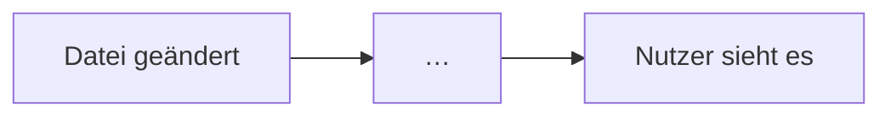

# Tech-Stack: [Projektname]

> **Stand:** JJJJ-MM-TT · **Commit:** `[kurzer Hash]` · **Ausgefüllt von:** [Name oder KI] ·
> **Geprüft von:** [dein Name, erst wenn du Abschnitt 12 selbst beantwortet hast]

---

## Bevor du ausfüllst (danach löschen)

Diese Vorlage beantwortet eine einzige Frage: **Woraus besteht das Projekt, und warum so?**

Sie beantwortet nicht, was sich diese Woche geändert hat (das steht im Git-Log), wie es aussieht
(Design-Doku) oder was es können soll (Produkt-Doku). Wer das hier hineinmischt, bekommt ein
Dokument, das nach drei Wochen veraltet ist.

Fünf Regeln halten das Dokument brauchbar:

1. **Kein Fachwort ohne Erklärung.** Beim ersten Vorkommen in Klammern erklären oder ins Glossar
   (Abschnitt 11). Test: Versteht es jemand, der programmieren kann, das Werkzeug aber nie gesehen
   hat?
2. **Jede Behauptung hat eine Fundstelle.** Eine Datei, besser Datei und Zeile. Ohne Fundstelle ist
   es eine Vermutung.
3. **Lücken markieren statt füllen.** `❓ offen: <Frage>` ist besser als ein plausibler Satz. Das
   gilt besonders, wenn eine KI ausfüllt.
4. **Stabiles erklären, Flüchtiges verlinken.** Was sich laufend ändert (Liste aller Seiten, aller
   Komponenten, exakte Versionen), bleibt im Code oder in einer erzeugten Datei. Hier steht, was ein
   halbes Jahr hält.
5. **„Gibt es nicht“ ist eine Antwort.** Abschnitte, die nicht zutreffen (keine Datenbank, kein
   Login), nicht löschen, sondern mit einem Satz beantworten. Dass etwas fehlt, ist eine
   Architekturentscheidung.

Platzhalter stehen in [eckigen Klammern]. Hinweise zum Ausfüllen stehen in Zeilen mit ✏️; beides
wird am Ende ersetzt oder gelöscht.

**Wo du die Fakten findest:**

| Gesucht         | JavaScript / TypeScript                               | Python                               | Swift / Apple                  | Überall                       |
| --------------- | ----------------------------------------------------- | ------------------------------------ | ------------------------------ | ----------------------------- |
| Abhängigkeiten  | `package.json`                                        | `pyproject.toml`, `requirements.txt` | `Package.swift`, `*.xcodeproj` | `Dockerfile`                  |
| Befehle         | `package.json` → `scripts`                            | `Makefile`, `pyproject.toml`         | Xcode-Schemes                  | `README.md`                   |
| Konfiguration   | `*.config.js`, `*.config.ts`, `tsconfig.json`         | `settings.py`, `config.py`           | `Info.plist`                   | `.env.example`                |
| Hosting         | `vercel.json`, `netlify.toml`, `wrangler.toml`        | `Procfile`, `fly.toml`               | App Store Connect              | `.github/workflows/`, `CNAME` |
| Datenbank       | `drizzle.config.ts`, `prisma/schema.prisma`           | `models.py`, `alembic/`              | SwiftData- / Core-Data-Modelle | `docker-compose.yml`          |
| Läuft im Client | `<script>`, `"use client"`, `client:*`, `public/*.js` | Templates mit `<script>`, `static/`  | die ganze App                  | Browser-Entwicklertools       |

---

## 1. In 30 Sekunden

> ✏️ Vier kurze Antworten, die ein Freund ohne Informatik versteht.

**Was ist das?** [ein Satz: was es tut und für wen]

**Projektart:** [statische Website · Web-App mit eigenem Server · API / Backend · Mobile App ·
Desktop-App · Kommandozeilenwerkzeug · Spiel · Bibliothek]

**Denkbild:** [ein Alltagsvergleich für den ganzen Ablauf]

> ✏️ Beispiele: Statische Website = „Druckerei: einmal drucken, danach nur verteilen.“ Web-App mit
> Datenbank = „Restaurant: jede Bestellung wird frisch in der Küche zubereitet.“ Mobile App =
> „Werkzeugkasten, den jeder Nutzer bei sich trägt; das Backend ist das Lager, aus dem er Nachschub
> holt.“

**Das eine, was man verstanden haben muss:** [der Kernmechanismus in einem Satz]

> ✏️ Beispiele: „Seiten entstehen beim Bauen, nicht beim Aufruf.“ · „Jede Anfrage geht an den
> Server, der fragt die Datenbank.“ · „Die App funktioniert offline und gleicht später ab.“

---

## 2. Der Stack nach Schichten

> ✏️ Jedes Software-Projekt beantwortet dieselben zehn Fragen. Eine Zeile pro Frage, auch wenn die
> Antwort „gibt es nicht“ ist. Nur die Hauptversion nennen, die genaue steht in der
> Abhängigkeitsdatei.
>
> ✏️ Die Spalte **Wie tief?** sagt dir, wo sich Lernzeit lohnt: **Kern** = ohne das verstehst du das
> Projekt nicht · **Kennen** = wissen, wofür es da ist, reicht · **Ignorieren** = Hilfswerkzeug, läuft
> von selbst.

| Schicht            | Frage                                                        | Werkzeug (Version) | Wie tief? | Fundstelle |
| ------------------ | ------------------------------------------------------------ | ------------------ | --------- | ---------- |
| Sprache            | Worin ist der Code geschrieben?                              |                    |           |            |
| Framework          | Was gibt dem Code seine Struktur?                            |                    |           |            |
| Darstellung        | Wie entsteht das Aussehen?                                   |                    |           |            |
| Daten              | Wo liegen Inhalte und Nutzerdaten?                           |                    |           |            |
| Logik zur Laufzeit | Welcher Code läuft, während jemand das Produkt benutzt – wo? |                    |           |            |
| Identität          | Wer darf was? (Login, Rollen)                                |                    |           |            |
| Auslieferung       | Wo läuft es, und wie kommt es dorthin?                       |                    |           |            |
| Automatik          | Was prüft und veröffentlicht von selbst?                     |                    |           |            |
| Qualität           | Was fängt Fehler ab, bevor Nutzer sie sehen?                 |                    |           |            |
| Externe Dienste    | Wovon hängt das Projekt außerhalb des Repositorys ab?        |                    |           |            |

**Ignorieren darfst du:** [Hilfspakete, die in der Abhängigkeitsdatei stehen, aber hier nicht
auftauchen, jeweils mit einem Halbsatz, wofür sie da sind]

---

## 3. Steckbriefe der Kern-Werkzeuge

> ✏️ Ein Steckbrief je Werkzeug, das in Abschnitt 2 „Kern“ ist. Für „Kennen“-Werkzeuge nur, wenn sie
> oft Fragen aufwerfen. Nicht für jede Abhängigkeit.

### [Werkzeug]

| Frage                             | Antwort                                                      |
| --------------------------------- | ------------------------------------------------------------ |
| **Was ist das?**                  | [ein Satz ohne Fachwort]                                     |
| **Alltagsvergleich**              |                                                              |
| **Welches Problem löst es hier?** | [konkret in diesem Projekt, nicht allgemein]                 |
| **Woran erkenne ich es im Code?** | [Dateiendungen, Ordner, eine typische Zeile]                 |
| **Was wäre ohne es?**             | [was man dann selbst bauen oder anders lösen müsste]         |
| **Verworfene Alternativen**       | [welche, und warum nicht – mit Fundstelle, sonst ❓ offen]   |
| **Wenn du schon X kennst**        | [Brücke zu einem Werkzeug, das du bereits kannst (optional)] |
| **Offizielle Doku**               | [Link]                                                       |

---

## 4. Wann läuft welcher Code?

> ✏️ Der häufigste Denkfehler: nicht zu wissen, _wann_ und _wo_ ein Stück Code läuft. „Nichts“ ist
> eine gültige und wichtige Antwort.

| Zeitpunkt                     | Wo                   | Was läuft | Beispiel-Datei |
| ----------------------------- | -------------------- | --------- | -------------- |
| Beim Entwickeln               | dein Rechner         |           |                |
| Beim Bauen (Build)            | dein Rechner oder CI |           |                |
| Auf dem Server, pro Anfrage   | Hosting              |           |                |
| Im Browser / auf dem Gerät    | beim Nutzer          |           |                |
| Im Hintergrund, zeitgesteuert |                      |           |                |

### Der Weg einer Änderung bis zum Nutzer

> ✏️ Beginne bei „ich speichere eine Datei“, ende bei „Nutzer sieht es“. Nenne bei jedem Schritt,
> was dort schiefgehen kann – genau das brauchst du, wenn es schiefgeht.



1. **[Schritt]** – [was passiert]. _Kann scheitern an:_ […]

---

## 5. Ordnerkarte

> ✏️ Nur die Ordner und Dateien, die man kennen muss. Die dritte Spalte ist die wichtigste.

| Ordner / Datei | Was liegt da | Fasse ich an?                     |
| -------------- | ------------ | --------------------------------- |
|                |              | oft · selten · nie (wird erzeugt) |

---

## 6. Befehle

### Vom leeren Rechner zum laufenden Projekt

> ✏️ Jeder Schritt kopierbar. Voraussetzungen ausdrücklich nennen: Sprachversion, Docker, Konten,
> `.env`-Datei. Wenn keine nötig sind, das auch sagen.

1. Voraussetzungen: […]
2. […]

### Alltag

| Befehl | Was passiert | Wann brauche ich ihn |
| ------ | ------------ | -------------------- |
|        |              |                      |

---

## 7. Daten, Zustand und Geheimnisse

> ✏️ Auch wenn überall „keine“ steht: Dann ist das der kürzeste Abschnitt und eine wichtige Aussage.

| Frage                                               | Antwort                         | Fundstelle |
| --------------------------------------------------- | ------------------------------- | ---------- |
| Wo liegen die Inhalte?                              |                                 |            |
| Wo liegen Nutzerdaten?                              |                                 |            |
| Gibt es eine Datenbank? Welche, wo betrieben?       |                                 |            |
| Was speichert der Browser oder das Gerät?           |                                 |            |
| Was passiert mit Eingaben von Nutzern?              |                                 |            |
| Wo liegen Zugangsdaten (API-Schlüssel, Passwörter)? | [nur der Ort, niemals der Wert] |            |
| Gibt es Backups? Wer kann wiederherstellen?         |                                 |            |

---

## 8. Externe Dienste

> ✏️ Alles außerhalb des Repositorys, ohne das etwas nicht geht – auch Domain und E-Mail. „Konto
> bei“ klärt, wer im Notfall Zugriff hat.

| Dienst | Wofür | Wenn er ausfällt … | Kosten | Konto bei |
| ------ | ----- | ------------------ | ------ | --------- |
|        |       |                    |        |           |

---

## 9. Entscheidungen

> ✏️ Die drei bis sieben Entscheidungen, die das Projekt prägen. Jede mit ihrem Preis: Eine
> Entscheidung ohne Nachteil ist keine Entscheidung, sondern eine Behauptung.

| Entscheidung | Warum | Preis (was wir dafür aufgeben) | Neu entscheiden, wenn … |
| ------------ | ----- | ------------------------------ | ----------------------- |
|              |       |                                |                         |

---

## 10. Rezepte und Fehlersuche

### Wo ändere ich …?

| Aufgabe | Datei(en) | Danach prüfen mit |
| ------- | --------- | ----------------- |
|         |           |                   |

### Wenn etwas kaputt ist

| Symptom | Ursache meistens | Zuerst nachsehen / tun |
| ------- | ---------------- | ---------------------- |
|         |                  |                        |

---

## 11. Glossar

> ✏️ Jedes Fachwort aus diesem Dokument, das nicht allgemein bekannt ist. Die dritte Spalte verankert
> es im Projekt. Ein Glossar ohne sie erklärt Wikipedia, nicht dein Projekt.

| Begriff | Bedeutung in einem Satz | Hier im Projekt |
| ------- | ----------------------- | --------------- |
|         |                         |                 |

---

## 12. Verständnis-Check

> ✏️ **Die Antworten schreibst du selbst, nicht die KI.** Aus dem Kopf, in eigenen Worten, dann die
> Musterlösung aufklappen und vergleichen. Erst wenn alle sitzen, trägst du dich oben bei „Geprüft
> von“ ein. Die Fragen und Musterlösungen darf eine KI schreiben.
>
> ✏️ Die ersten fünf Fragen passen auf jedes Projekt. Ergänze ein bis drei, die nur hier Sinn ergeben.

**1. Was passiert zwischen „ich speichere eine Datei“ und „ein Nutzer sieht die Änderung“?**

Meine Antwort:

<details>
<summary>Musterlösung</summary>

…

</details>

**2. Welcher Code läuft beim Nutzer, welcher nie?**

Meine Antwort:

<details>
<summary>Musterlösung</summary>

…

</details>

**3. Wo liegen die Daten, und was geht verloren, wenn [Hosting oder wichtigster Dienst] morgen
abschaltet?**

Meine Antwort:

<details>
<summary>Musterlösung</summary>

…

</details>

**4. Welches Werkzeug ließe sich am leichtesten austauschen, welches am schwersten, und warum?**

Meine Antwort:

<details>
<summary>Musterlösung</summary>

…

</details>

**5. Ein Nutzer meldet „[typischer Fehler]“. Wo schaust du zuerst?**

Meine Antwort:

<details>
<summary>Musterlösung</summary>

…

</details>

---

## 13. Pflege

**Aktualisieren, wenn** ein Werkzeug aus Abschnitt 2 dazukommt oder wegfällt, Hosting oder
Datenhaltung wechselt, ein externer Dienst dazukommt oder ein Befehl aus Abschnitt 6 nicht mehr
stimmt.

**Nicht aktualisieren für** Text-, Inhalts- und Designänderungen oder neue Seiten im bestehenden
Muster. Die ändern den Stack nicht.

**Schnelltest auf Veraltung:** Abhängigkeitsdatei neben Abschnitt 2 legen. Steht dort ein Werkzeug,
das hier fehlt, oder umgekehrt, ist das Dokument veraltet. Dann Abschnitt 6 einmal von oben nach
unten auf einem frischen Klon ausführen.

---

## Anhang: Auftrag an eine KI

> Zum Kopieren. Funktioniert mit Claude Code im Projektordner oder mit jeder KI, die das Repository
> lesen kann. Danach Abschnitt 12 selbst beantworten – sonst hast du nur ein weiteres Dokument, das du
> nicht verstehst.

```text
Fülle die Vorlage <Pfad oder Link zu TECH-STACK-VORLAGE.md> für dieses Repository aus und speichere
sie als docs/TECH-STACK.md.

1. Lies zuerst Abhängigkeits- und Konfigurationsdateien (package.json, pyproject.toml, Dockerfile,
   *.config.*, .github/workflows/, .env.example), dann README und vorhandene Dokumentation.
2. Prüfe jede Aussage am Code und nenne eine Fundstelle (Datei, wenn möglich mit Zeile).
   Begründungen für Entscheidungen nur, wenn sie irgendwo im Repository stehen.
3. Was du nicht belegen kannst, markierst du als „❓ offen: <Frage>“. Nicht raten.
4. Schreibe für jemanden, der programmieren kann, diese Werkzeuge aber nicht kennt. Jedes Fachwort
   beim ersten Auftreten erklären oder ins Glossar.
5. Nicht zutreffende Abschnitte mit einem Satz beantworten („Es gibt keine Datenbank, weil …“),
   nicht löschen.
6. Abschnitt 12: Fragen und Musterlösungen schreiben, die Felder „Meine Antwort“ leer lassen.
7. Keine Änderungshistorie, keine Wochenzusammenfassung, keine Werte von Zugangsdaten.
8. Den Abschnitt „Bevor du ausfüllst“ und alle ✏️-Zeilen löschen, alle [Platzhalter] ersetzen.

Zum Schluss: Liste alle ❓-Stellen auf und nenne die drei Begriffe, die am schwersten zu erklären
waren.
```
